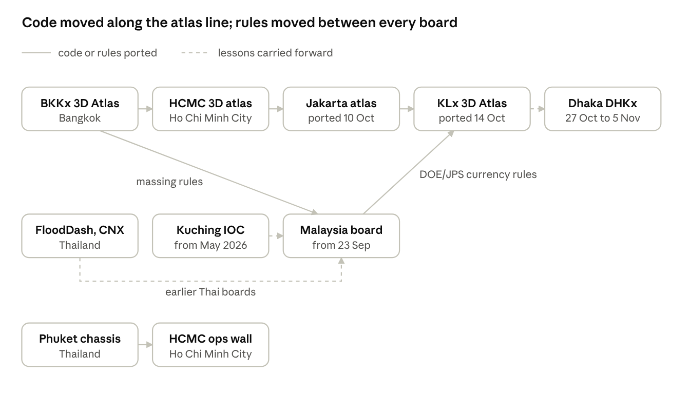

# Democratizing Effective Decision-Making through Dashboard Building

## Experience with Building Dashboards for Major Metropoles in Southeast and South Asia

**Non Arkaraprasertkul**, Digital Economy Promotion Agency of Thailand (depa)

**Preprint, version 1, 5 November 2026. Not peer reviewed.**

*A note on geography.* Four of the five cities — Kuala Lumpur, Kuching, Ho Chi Minh City and Jakarta — are in Southeast Asia. Dhaka is in South Asia. The title says so rather than stretch "Southeast Asia" to fit the sample.

## Abstract

A city dashboard used to be a procurement: a control room, a vendor, a multi-year contract and a screen only officials could see. Between May and November 2026 I built five public, multilingual decision boards for Kuala Lumpur (with a national Malaysia board), Kuching, Ho Chi Minh City, Jakarta and Dhaka. Each was built by one researcher, the author, working with several AI coding agents, on open data, at the cost of static hosting. This paper reports what that experience teaches about democratizing decision-making.

My argument is that cheap production is the easy half. Once anyone can build a dashboard, the scarce good is not the screen but the honesty of what it says. Across the five repositories, the boards converged independently on five principles: (1) every number carries its evidence tier — observed, modelled, reference, derived or simulated; (2) missing data is never rendered as calm; (3) the map owns the screen, and interface chrome must justify the space it takes; (4) a deployment is proven by reading the live site, not by the upload succeeding; and (5) a public board refuses physics simulation it cannot run honestly.

Each principle was earned by a dated failure, recorded in the repositories and then pinned by an automated test. Examples include a rain total displayed four times too low for months, a frozen "normal" river reading on an operations centre, a generated grid of buildings that does not exist, and a deploy that reported success while serving a 404. I present a comparative description of the five boards, a catalogue of these failures, and the rule each one produced. I am explicit about the limits: all five boards are self-declared demonstrations, and none of the repositories contains usage or impact data. The contribution is therefore a method and a set of tested rules, not a claim of outcomes.

**Keywords:** city dashboards; smart cities; open data; decision support; AI-assisted software development; data provenance; Southeast Asia; South Asia

## 1. Introduction

Who gets to decide with a dashboard? For most of the smart-city era the answer was whoever owned the control room. An integrated operations centre (IOC) was a building, a vendor relationship and a wall of screens. The data behind it was usually public in origin — rain gauges, air stations, weather models, satellite passes — but the synthesis was private, expensive and slow to change. A resident, a district officer or a visiting delegation saw the output, if at all, as a photograph of the wall.

Two things changed in 2026. First, the public data became reachable from a browser: national agencies, Copernicus, NASA and open-model providers now publish machine-readable feeds that a static website can relay. Second, AI coding agents made it possible for one researcher, who is not a full-time software engineer, to build and maintain a working multi-feed board in weeks rather than a team in years. The marginal cost of a dashboard collapsed towards the cost of a domain name and free-tier hosting.

This is a democratization of *production*. It is not yet a democratization of *decision-making*, and the gap between the two is the subject of this paper. A cheap dashboard can mislead as fluently as an expensive one — more fluently, in fact, because an AI agent will produce a confident, well-designed screen whether or not the number on it is current, correctly labelled with its unit or real. In my experience the default failure of agent-built dashboards is not ugliness. It is plausibility.

I report on five boards I built between May and November 2026 for Kuala Lumpur and Malaysia, Kuching, Ho Chi Minh City, Jakarta and Dhaka. All are public on the web, all are multilingual, and every one was made with several AI coding agents (the repositories name Claude, Codex, Gemini, GLM, MiniMax and Nemotron among them). Each repository carries a written rulebook for those agents, a dated record of failures, and an automated test suite. That record is my primary evidence.

My claim is modest in scope and firm in substance. I do not claim that these boards improved any decision; the repositories contain no usage or impact data, and all five describe themselves as demonstrations. I claim that, read together, the five records show the same small set of rules emerging independently in five cities, each rule paid for by a specific failure. Those rules are what makes a cheap dashboard fit to inform a decision. They are also teachable, testable and transferable, which is what democratization actually requires.

The paper proceeds as follows. Section 2 describes the five boards. Section 3 describes the method: building with agents under a written owner's law. Section 4 sets out the five principles. Section 5 catalogues the failures that produced them. Section 6 discusses what "democratizing" can and cannot mean on this evidence, and Section 7 concludes.

## 2. Five boards

The five boards share a builder, a hosting model and a set of rules. They differ in the reader they serve, the language they lead with and the decision they are built around. Table 1 summarises them in order of construction. Every entry comes from the repository's own README, rulebook or audit files, and the maturity column quotes each board's own self-assessment.

**Table 1. The five boards (six surfaces), as recorded in their repositories, 5 November 2026**

| Board | Public address | Languages | Reader named in the repository | Stack and hosting | Self-declared maturity | Automated checks |
| --- | --- | --- | --- | --- | --- | --- |
| Greater Kuching IOC | kuching.nonarkara.org | English, Malay, Chinese | The Secretary of the Padawan Municipal Council (MPP), across three councils | Node relay server, plain JavaScript, Leaflet and CesiumJS; Cloudflare Pages serving a snapshot rebuilt about every 4 h | "Supervised demonstration only" | 29 test files, about 197 tests |
| Malaysia national board, with KL scene and KL IOC | malaysia.nonarkara.org | English, Malay, Chinese | The public and the Malaysian delegation to Tomorrow City Shanghai 2026 | Static Cloudflare Pages site with same-origin relays; Leaflet 2D, MapLibre 3D; no runtime dependencies | "Independent demonstration … not an official product" | 63 test files, 365 tests |
| KLx 3D Atlas | kl.nonarkara.org | Malay first, English | The public; a 3D atlas of Kuala Lumpur | Cloudflare Worker; buildings streamed as PMTiles from R2 | "Public demo (T0/T1)" | 9 chained test scripts |
| Ho Chi Minh City operations wall | hcmc.nonarkara.org | Vietnamese, English | A governor and VNTT concept demonstration on a 72-inch 4K wall | Next.js and deck.gl on Cloudflare Workers, with D1 and R2 | "Demo. Stated honestly" | 9 test suites, run locally |
| Jakarta dashboard and atlas | jakarta.nonarkara.org | Indonesian first, English | Staff at Jakarta Smart City checking water, rain, air and warnings on a phone each morning | Cloudflare Worker; buildings and waterways as PMTiles from R2 | "T0 demo" | About 60 test and mutation scripts |
| Dhaka atlas and civic dashboard (DHKx) | dhaka.nonarkara.org | Bengali first, English | A resident or civic analyst inspecting a place and its evidence | Cloudflare Worker with D1, R2 and a 15-minute collection schedule | Inspection tool; operational warnings marked "unavailable" | 18 test suites |

Three observations follow from the table.

First, the boards are cheap by construction. All six surfaces run on Cloudflare's static or edge tiers. None needs a database server, a GPU or a licence fee to stay online. The Malaysia board ships with no runtime software dependencies at all.

Second, each board leads in the language of its reader, not of its builder. Kuching and Malaysia are trilingual (English, Malay, Chinese). Jakarta defaults to Indonesian, Dhaka to Bengali, Ho Chi Minh City offers Vietnamese, and the KL atlas leads with Malay. The KL atlas records its Malay as "not a find-and-replace", and Jakarta and Dhaka switch number formats with the language.

Third, every board under-claims its own status. None calls itself operational. Kuching states that it is "not a flood warning, a haze declaration, or an evacuation order"; Dhaka marks flood tiers, harvest advice and shelter readiness as unavailable rather than guessing them; Ho Chi Minh City rates itself "Demo" because it has "no live VNTT feed, no database, no CI on push". This self-restraint is not modesty for its own sake. As Section 5 shows, most of it was written immediately after a board claimed more than it could support.

## 3. Method: building with agents under a written law

### 3.1 One builder, many agents, separate auditors

I am an architect and anthropologist, not a professional programmer. I set the purpose, the reader and the rules of each board, and AI coding agents wrote most of the code. The repositories name at least six agents across the five cities. This arrangement is the source of both the speed and the risk. An agent writes fluently, and it reports its own success just as fluently.

The boards therefore separate building from judging. The Dhaka record states that builder and auditor should be different agents, after a builder's self-audit reported a map share of "≈94%" that was "not measured"; the real interface chrome took about 30% of the screen. Ho Chi Minh City's design rule is that "an independent reviewer signs the verdict, the author does not". Jakarta goes further and mutates its own guards to prove they can fail: "A gate that has never failed protects nothing." The Malaysia board, the subject of the most audit rounds, records reviews of work by several agents in turn, each checked against the live site rather than against the agent's report.

### 3.2 The rulebook as a constitution

Each repository carries a rulebook for its agents, usually named AGENTS.md or CLAUDE.md. The rulebooks are written in the owner's voice, dated, and expected to be read before any code is written. They are short on aspiration and long on specific prohibitions, each with the incident that motivated it. A representative line, shared verbatim by the Kuching and Malaysia rulebooks, is the owner's instruction on interface clutter: "When you find SH, massacre." Another, from the Malaysia rulebook, records a design decision as a binding constraint: the masthead plus the closed safety summary must stay at or under 156.64 pixels on a phone, half the measured original.

The rulebook does three jobs. It transfers the owner's judgement to agents that have no memory between sessions. It makes that judgement inspectable by anyone who reads the repository. And it prevents regression, because the next agent meets the reason for a rule before it meets the code the rule protects.

### 3.3 From failure to test

Across the five repositories the same cycle recurs:

1. A failure is found by *measuring the live board* — opening it in a browser at fixed screen sizes, reading the deployed bytes, or comparing a displayed value with its upstream source — not by reading the code.
2. The failure is written into a dated record (context.md, JOURNAL.md, an audit file or a research note) with the measured numbers.
3. A rule is added to the rulebook, stated as a constraint rather than a wish.
4. An automated test pins the rule, ideally by exercising the behaviour rather than searching the source text.
5. The deploy script refuses to ship unless the tests pass, and then reads the live site to confirm that what shipped is what was tested.

The cycle is unremarkable in software engineering. What is notable is that it was sustained by a non-programmer directing agents, and that it produced the same rules in five cities.

### 3.4 Lineage

The boards are not independent samples. Code and rules moved between them, as Figure 1 shows. The 3D atlas engine was ported in a chain from Bangkok (BKKx) to Ho Chi Minh City, then to Jakarta on 10 October 2026, then to Kuala Lumpur on 14 October. The Malaysia board adopted BKKx's building-massing rules, and the KL atlas in turn adopted the Malaysia board's observation-currency rules "verbatim" on 15 October. Dhaka, the last board, records that it "learned from" Bangkok, Ho Chi Minh City, Jakarta and Kuala Lumpur.

*Figure 1. Lineage of the boards, 2026; dates from each repository's dated records. Solid arrows: code or rules ported. Dashed arrows: lessons carried forward.*

The top row is one engine moving city to city; the middle row is the operations-board line that produced the Malaysia board. The diagonals are where the two lines exchanged rules.

### 3.5 Evidence and its limits

My evidence is the five repositories as they stood on 5 November 2026: rulebooks, dated records, audit files, tests and deploy scripts. Four of the clones I examined are shallow, so dates for those boards come from their dated documents rather than from version history. The Malaysia repository carries its full history (156 commits on its main branch since 23 September 2026).

I built the boards and am also a subject of this study. I treat this as an anthropologist treats participant observation: as access that must be disciplined, not as a neutrality I can claim. The discipline here is that every claim in Sections 4 and 5 cites a file that a reader can open. None of the repositories records how many people used a board, or what any reader decided. I make no such claims.

## 4. Five principles the boards converged on

Five rules appear in all five repositories, worded differently and arrived at separately. Table 2 shows how each board states or enforces them. Read across a row and the convergence is plain; read down a column and each board's character shows.

**Table 2. The five principles as each board implements them**

| Principle | Kuching | Malaysia and KL | Ho Chi Minh City | Jakarta | Dhaka |
| --- | --- | --- | --- | --- | --- |
| 1. Every number carries its evidence tier | The official reading wins; modelled air quality is "labelled as a model"; illustrative constants carry a badge | Observed, modelled, reference and derived kept apart; simulated surfaces say SIMULATED | Tiers live, hybrid, cached, portal-only, simulated, unavailable; corridor traffic "always labeled MODELED" | Each of 43 integrated sources carries a tier; each building height names its source | Tiers measured, modeled, simulated, reference, unavailable |
| 2. Missing is never calm | A missing feed returns "not-connected" with no rows | A down feed reads "—", never its last count; no station means "unknown, not clean" | Status reports degraded (HTTP 503) when the heartbeat is over 20 min old | "Missing data is never an all-clear and never a zero" | "unavailable" plus a machine-readable reason; a thin collection cannot replace the last good one |
| 3. The map owns the screen | "The map is the room"; the left sidebar was removed | Map at least 65% of desktop height; chrome budgets of 156.64 px (phone) and 73.25 px (desktop) | Map at least 60%; top bars at most 56 px | Phone masthead 27 px; a chrome census with its own falsifier | Header 48 px; map at least 60% at three widths |
| 4. The upload is not the delivery | Snapshot rebuilt and deployed by CI; the spatial gate only records in CI | Deploy refuses an unclean or unsynced tree, then waits for the live page to carry the release id | Live bytes checked by SHA-256 and build stamp | Refuses an uncommitted tree; checks the exact deployed bytes on both hosts | Live bytes matched by SHA-256; satellite tiles decoded before their date is accepted |
| 5. Refuse the simulator you cannot run | "No hydraulic model"; browser back-trajectory labelled "not HYSPLIT" | WRF-Chem, CMAQ, HYSPLIT, Delft3D and others ruled out in a dated note | SWMM calibration deferred: it would "fit a model to a model" | Heavy simulators kept to an "offline path" | Flood tiers, smoke transport and fire attribution marked unavailable |

### 4.1 Every number carries its evidence tier

A dashboard puts numbers next to each other, and adjacency is an argument. Place a station's air-quality index of 184 beside a model's PM2.5 of 94 µg/m³ and a reader will compare them, though they measure different things in different units by different methods. The Malaysia rulebook uses exactly this pair as its example: labelled, they are "two clearly-labelled signals"; if one came from "a two-day-old bake nobody recalibrated", the pair "is a lie by adjacency". Its rule names three tiers — observed, modelled and simulated — that "must never blur into each other", and adds a fourth, *derived*, for arithmetic the board performs on readings.

The five boards differ in vocabulary but not in intent. Every one of them separates a reading from an estimate, and every one prints that separation next to the number rather than in a footnote. The cost is visual: more labels, more words. The benefit is that a reader who is not a scientist can still tell which numbers were seen and which were guessed.

### 4.2 Missing is never calm

The most dangerous number on a public board is a calm one that is not current. A feed that fails silently leaves its last value on screen, and the last value of a river gauge on a dry morning is "normal". Every board now treats absence as a state in its own right: grey, a dash, "unavailable", "unknown, not clean". Jakarta's rule is the most compact formulation: "Missing data is never an all-clear and never a zero."

This is the principle most directly tied to democratization. A trained duty officer knows that a quiet screen may mean a dead feed. A resident does not. A board for the public must say out loud what an expert would infer.

### 4.3 The map owns the screen

All five boards are map-first, and all five set a numeric budget for everything that is not map. The Malaysia rulebook frames this as *antiSHism*, from the owner's definition of spatial hallucination: "when an interface invents a reason for things to occupy space, instead of arranging them around how people read, choose and act." The test it proposes is an architect's question: "Why is this here, why this size, and why this far from that?" "The grid put it there" is recorded as a failed answer.

The budgets are measured, not eyeballed, in a real browser after the feeds load, at fixed sizes such as 375×812 and 1280×720. The Malaysia board halved its interface chrome in October 2026 — from 313.29 to at most 156.64 pixels on a phone — while keeping every warning visible. The principle is not minimalism. A warning may take the space it needs; decoration may not.

### 4.4 The upload is not the delivery

A dashboard that says the right thing in the repository and the wrong thing on the web has said the wrong thing. Each board's deploy script ends by reading the live site, not by trusting the upload. The Malaysia script waits until the public page carries the new release id; Ho Chi Minh City, Jakarta and Dhaka compare the deployed bytes by hash. The Malaysia rulebook also notes a trap specific to static hosting: with a fallback to the main page, every unknown path returns HTTP 200, so "HTTP status cannot prove what shipped".

### 4.5 Refuse the simulator you cannot run

Every board stops short of physics simulation — flood hydraulics, atmospheric chemistry, smoke trajectories — and says so. The reasons are partly practical: a static public site has no compute node, and a per-request solve would be an open invitation to unbounded cost. They are mainly epistemic. A stale simulation shown next to a live observation borrows the observation's credibility. The Malaysia note on the subject compresses the stance into five words: "Take the epistemics, not the engines." Ho Chi Minh City's version is sharper still: calibrating a flood model without a measured water level would "fit a model to a model".

## 5. A catalogue of failures

The principles of Section 4 were not designed in advance. Each was written down after a board got something wrong in public, or nearly did. Table 3 lists 22 of these failures, newest first, with the rule each one produced. I chose the failures that are most instructive, not a complete census; all are recorded in the repositories with their dates.

**Table 3. Twenty-two recorded failures and the rules they produced, May–November 2026**

| Date | Board | Kind | What went wrong, as recorded | Rule it produced |
| --- | --- | --- | --- | --- |
| 5 Nov | Malaysia | Space | Naming a third failed feed made the closed outage line wrap on phones: 159 px against a 156.64 px budget | Failed feeds grouped by state on one line; every feed still named |
| 5 Nov | Jakarta | Delivery | An agent's change broke the live boot on an undefined function and removed earned controls | Masthead repaired with regression evidence kept in the repository |
| 4 Nov | Dhaka | Unverified check | Earlier test-suite counts were "inaccurate"; a transparent-pixel "false green" passed the satellite check | Counts taken from the runner; tiles decoded before acceptance |
| 3 Nov | Malaysia | Invented content | A fire "impact" panel invented an area (FRP ÷ 10 km²) and a danger class; an emoji replaced the "Worst DOE API" label | Panel removed; text labels restored beside symbols |
| 1 Nov | Dhaka | Unverified check | The builder's self-audit reported the map at "≈94%", "not measured"; chrome took about 30% | Builder and auditor are different agents |
| 29 Oct | Malaysia | Stale or mistimed | The aerosol layer assumed "yesterday", but the product lags two days: every tile returned 404 and nothing was drawn | Satellite dates come from the provider, never assumed |
| 29 Oct | Malaysia | Delivery | A live strip was built on a page that had been unreachable since 13 Oct | Prove a visitor can reach a page before building on it |
| 29 Oct | Jakarta | Unverified check | A bar built as a plain div made the chrome instrument read 0 px, and "the gate went green on a page that has chrome" | The chrome census carries a falsifier |
| 28 Oct | Dhaka | Invented content | Watch readings were constants, no building extrusion existed, and the 72-hour chart drew 48 bars, while eight checks passed | Behaviour tests replace source-presence checks |
| 28 Oct | Dhaka | Invented content | A harvest warning treated missing river discharge as safe and moved a seven-day maximum into a 72-hour window | Operational advice marked "unavailable" |
| 23 Oct | Ho Chi Minh City | Unverified check | "Five rounds of anti-slop reviewing passed a page that rendered no map"; the tiles were key-required watermarks | "A gate that cannot see must say so" |
| 22 Oct | Malaysia | Wrong unit | A 15-minute rain total was printed as mm/h "for months", understating intensity fourfold | Rain shown as a total with its window; thresholds compared on the rate |
| 22 Oct | Malaysia | Delivery | A deploy reported success while the root URL returned 404: 123 files uploaded, every asset key off by one directory | The deploy reads the live page and waits for this release |
| 19 Oct | Kuching | Stale or mistimed | A time lookup returned −1, and the board showed 30.8 °C during rain when the truth was 24.1 °C | Shared validators for window, continuity and age |
| 19 Oct | Jakarta | Stale or mistimed | A model was anchored to the nearest hour and borrowed neighbouring hours: "A gap became a lie" | A model is admitted only if it contains the current hour |
| 16 Oct | Malaysia | Delivery | A deploy from a stale checkout reverted a merged honesty fix, and its own smoke test passed | Deploy refuses unless the checkout equals the published main branch |
| 14 Oct | Malaysia (KL IOC) | Invented content | "DOE CAQM: 52" and "JPS RIVERS: NORMAL FLOW" were typed into the page; the live wiring read the wrong field names | No typed-in live values; tests pin the known fabrications |
| 14 Oct | Malaysia (KL scene) | Invented content | 4,171 of 5,494 building features were generated rectangles, drawn as if they were a city | The generated lattice is never drawn |
| 6 Oct | Ho Chi Minh City | Stale or mistimed | The sensor feed was 2,441 hours old, and model output was mislabelled | Status reports "degraded" past 20 minutes |
| 29 Sep | Kuching | Invented content | Hand-made ward projects with real contractor names and costs were shown as a council "Ledger", beside directives citing things that do not exist | Before any demo, every rendered number is traced to a fetch; what cannot be traced is deleted or flagged illustrative |
| 21 Jul | Kuching | Invented content | A hand-curated ward score of 92/100 was shown as measured, in a directive citing "public sentiment telemetry" that does not exist | Demo constants carry an ILLUSTRATIVE badge; the fabricated directive was deleted ("Deletion > soft-label") |
| 14 Jun | Kuching | Destructive edit | An agent's refactor cut the server from 3,430 to 462 lines | No file may shrink by more than 30% without approval |

Three patterns stand out.

**Invention is the commonest failure.** Seven of the 22 rows are invented content: a value, a record, a building or an instruction that no source supported. None was malicious. Each was what an agent produces when asked to make a screen look complete before the data exists. Invention is the natural failure of a fluent builder.

**Checks fail more quietly than code.** Four rows are checks that passed while the thing they guarded was broken: a gate that could not see the missing map, an instrument that measured zero chrome, a self-audit that reported a figure nobody measured. The Kuching record adds a fifth variant, a test that "pinned the buggy string" and "stayed green while the defect shipped". A test suite is evidence only when it has been seen to fail.

**Time and delivery are where honest boards go wrong.** Eight rows involve data that was old, mistimed or not actually delivered: the assumed satellite date, the borrowed model hour, the stale checkout, the 404 behind a success message. These are not failures of intent. They are failures of the gap between what the code says and what the visitor receives, which is why Principle 4 exists.

## 6. Discussion: what "democratizing" can mean on this evidence

The word carries at least three meanings, and the five boards support them unevenly.

### 6.1 Democratizing production: who can build

This is the strongest claim the evidence supports. One person who is not a software engineer built six public surfaces for five cities in about six months, on open data and edge hosting, with no runtime licence costs. A decade ago each would have been a procurement.

But the cost did not vanish; it moved. It moved from writing code to verifying it. In Jakarta, test and tooling scripts (about 13,300 lines) outweigh the application code (about 8,500 lines of client JavaScript). The Malaysia board carries 365 automated tests. Democratized production means the scarce skill is no longer programming. It is knowing what a true screen looks like, and refusing a false one however good it looks. That skill is closer to editing, auditing and fieldwork than to engineering, which is why an architect and anthropologist could exercise it.

### 6.2 Democratizing access: who can read

All five boards are public URLs with no login. Each leads in the language of its residents — Malay, Chinese, Indonesian, Vietnamese, Bengali — alongside English. All are designed to work on a phone. The Malaysia board prints the emergency number on its safety summary, and offers a sitrep that can be copied into a messaging app in three languages.

Access, however, is only as good as the honesty of what is accessed. Principle 2 is the hinge. An expert reading a control-room wall knows that silence may mean a dead feed; a resident reading a phone does not. A board for the public must therefore say what an expert would infer: that a missing reading is not a safe reading. Of the five principles, this one is most specifically a public-interest rule.

### 6.3 Democratizing judgement: who can check

The third sense is the one I think matters most and is least often discussed. Each repository publishes, in plain language, the rules its board follows and the failures that produced them. Anyone — a city officer, a journalist, a student, a sceptical engineer — can read why a number is shown, where it came from, how old it may be before it is withdrawn, and what the board refuses to say. The boards make their own epistemics inspectable.

This is not the same as handing decisions to the public. The boards are explicit that agencies decide. Kuching states that official agencies "outrank this board"; Dhaka declines to issue flood tiers or harvest advice; Malaysia directs readers to MET Malaysia, JPS and NADMA. What the boards democratize is the *evidence* that official decisions rest on, and the ability to see its gaps. A citizen who can see that, say, a fifth of the DOE stations are not reporting is better placed to ask the right question than one shown a single green tile.

### 6.4 Limits

I state the limits plainly, because the method of this paper is to under-claim.

- **No outcome evidence.** None of the repositories records usage, adoption, or any decision a board informed. All five describe themselves as demonstrations. Jakarta records that its administrator walkthrough "has not been run".
- **One builder.** The rules reflect one person's judgement, applied across five cities. Whether another builder, with different values, would converge on the same five principles is untested.
- **Unofficial status.** A well-made unofficial board can be mistaken for an official one. Every board carries a disclaimer; the Kuching audit also found that the board's named partner relationships were unconfirmed.
- **Dependence on upstreams.** The boards are only as current as their sources. Open-Meteo refuses requests from some cloud runners, and several feeds need keys the boards do not hold. Ho Chi Minh City records keys that remain in its history and need rotation.
- **Maintenance.** A board built in weeks must still be kept honest for years. The repositories show automated daily snapshots and release checks, but no institution yet owns any of them.
- **Sample.** The five cities were chosen by opportunity, not design, and the boards share code and rules (Figure 1). They are five cases of one practice, not five independent experiments.

## 7. Conclusion

AI coding agents have made the city dashboard cheap. That is real, and it is not the achievement. A cheap dashboard that invents a calm river, prints a rain total four times too low, or reports a successful deploy over a 404 is not a democratic tool. It is a faster way to be wrong in public.

Five boards in five cities, built by one researcher with many agents, converged on the same answer: the value of a public board lies in what it refuses to say. It refuses to blur a reading into an estimate. It refuses to render absence as safety. It refuses to let chrome crowd out the map, to trust an upload it has not read back, or to borrow credibility from a simulation it cannot run. Each refusal was learned from a dated failure and is now enforced by a test.

For a city agency, a university or a civic group that wants to build the next one, the transferable part is short:

1. Write the rulebook before the first screen, in plain language, and give each rule the incident that justifies it.
2. Label every number with its evidence tier and its age, on the screen, beside the number.
3. Design the absent state first: grey, a dash, "unavailable", never the last good value.
4. Separate the builder from the auditor, and audit the live site, not the report.
5. Make the deploy prove delivery by reading the public page back.
6. Keep the failure record public. It is the most useful document in each repository.

None of this requires a control room. All of it requires judgement. That, in the end, is what I think these boards democratize: not the screen, but the discipline of telling the truth on it.

## Disclosures and data

**Competing interests.** The author built all five boards and is therefore both author and subject of this study (Section 3.5). The boards are independent demonstrations and are not official products of any government named here.

**Use of AI.** The boards were built largely by AI coding agents, as described in Section 3. This manuscript was drafted with AI assistance from the repositories' own records; every quotation and figure should be checked by the author against the cited files before submission.

**Data availability.** All evidence is in the repositories listed below, as they stood on 5 November 2026. Several are private; access is at the author's discretion.

## Sources

**Live boards**

- Malaysia national board: [malaysia.nonarkara.org](https://malaysia.nonarkara.org/)
- KLx 3D Atlas: [kl.nonarkara.org](https://kl.nonarkara.org/)
- Greater Kuching IOC: [kuching.nonarkara.org](https://kuching.nonarkara.org/)
- Ho Chi Minh City operations wall: [hcmc.nonarkara.org](https://hcmc.nonarkara.org/)
- Jakarta dashboard and atlas: [jakarta.nonarkara.org](https://jakarta.nonarkara.org/)
- Dhaka atlas and civic dashboard: [dhaka.nonarkara.org](https://dhaka.nonarkara.org/)

**Repository records cited**

| Repository | Files cited |
| --- | --- |
| Nonarkara/Malaysia | AGENTS.md; context.md; README.md; scripts/deploy.mjs; docs/research/simulation-models-out-of-scope.md; docs/research/rain-unit-2026-10-22.md; docs/research/shipability-audit-2026-10-22.md; docs/research/half-chrome-2026-10-30.md; tests/ (63 files) |
| Nonarkara/kl-3d-atlas | README.md; context.md; public/observation-rules.js |
| Nonarkara/kuching-ioc | README.md; CLAUDE.md; JOURNAL.md; tasks/lessons.md; tasks/todo.md; RELEASE-AUDIT-2026-10-02.md; docs/MSH-LAW.md |
| Nonarkara/hcmc-dashboard | README.md; CLAUDE.md; context.md; STYLE.md; MSH.md; docs/SHIPABILITY-AUDIT-2026-10-23.md; docs/DATA-SOURCES.md; docs/audit-2026-10-06.md; docs/DIGITAL-TWIN-SYNTHESIS-2026-10-16.md |
| Nonarkara/jakarta-dashboard | README.md; context.md; STYLE.md; docs/ANTI-SLOP-DESIGN.md; docs/MSH-LAW.md; docs/DAILY-MONITORING-PILOT-2026-10-26.md; Scars/Debug-Logs/; public/data/jakarta-v1/source-catalog.json |
| Nonarkara/dhaka-dashboard | README.md; AGENTS.md; BEST-PRACTICES.md; context.md; STYLE.md; docs/MSH-AUDIT-2026-11-01.md; docs/evidence/minimax-audit-2026-10-28/README.md; scripts/test-api-truthfulness.mjs |
